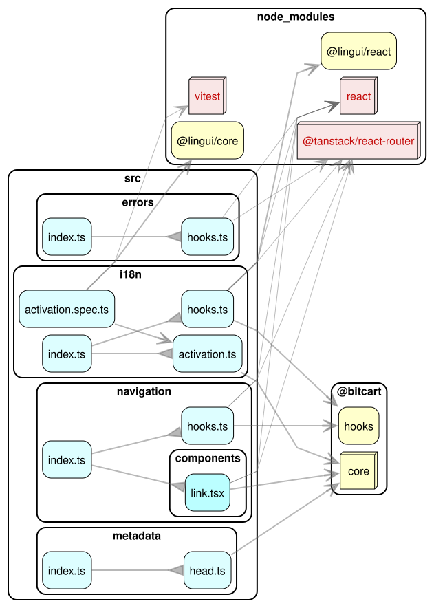

# Bitcart TanStack Start Kit

Shared TanStack Start integration for Bitcart applications: document head metadata, navigation, i18n activation, route error handling, 404 tracking and Fumadocs page preloading. It is the TanStack Start counterpart of `@bitcart/vike-kit`.

## Architecture

### Dependency graph

